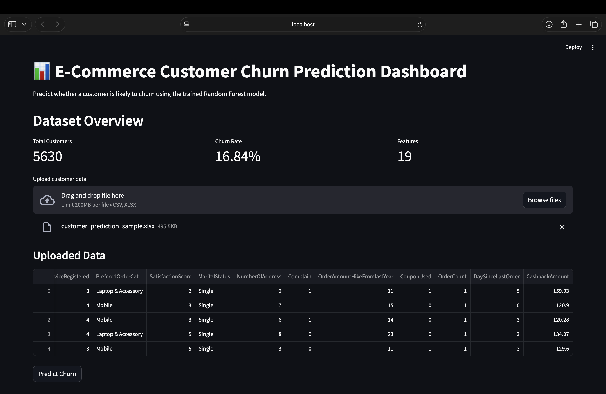
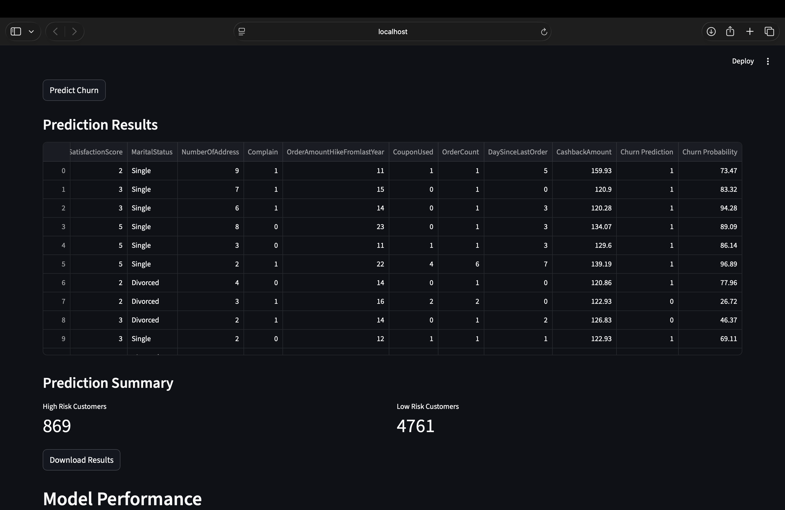
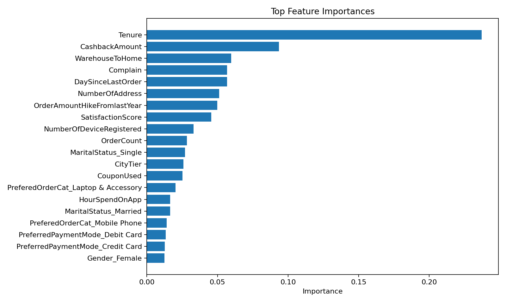

#  E-Commerce Customer Churn Prediction & Analytics Platform

A complete end-to-end Machine Learning application that predicts customer churn using a real-world E-Commerce dataset. The project includes data preprocessing, feature engineering, hyperparameter tuning, model comparison, business analytics, and an interactive Streamlit dashboard for real-time churn prediction.

---

##  Project Overview

Customer churn is one of the biggest challenges faced by subscription-based and E-Commerce businesses. This project develops a machine learning pipeline to identify customers who are likely to stop purchasing, enabling businesses to take proactive retention measures.

The project covers the complete ML workflow:

- Data preprocessing
- Missing value handling
- Feature engineering
- Model training & comparison
- Hyperparameter tuning
- Model evaluation
- Feature importance analysis
- Business recommendations
- Interactive Streamlit dashboard

---

# Dataset

**Dataset:** E-Commerce Customer Churn Dataset

- **Total Customers:** 5,630
- **Business Features:** 19
- **Target Variable:** Churn

Example features include:

- Tenure
- Cashback Amount
- Warehouse Distance
- Satisfaction Score
- Preferred Payment Mode
- Number of Orders
- Order Count
- Coupon Usage
- Complaint History
- Days Since Last Order

---

#  Tech Stack

### Programming

- Python

### Data Analysis

- Pandas
- NumPy

### Machine Learning

- Scikit-Learn
- XGBoost

### Models

- Logistic Regression
- Random Forest
- Gradient Boosting
- XGBoost

### Hyperparameter Optimization

- RandomizedSearchCV

### Visualization

- Matplotlib

### Dashboard

- Streamlit

### Model Storage

- Joblib

---

# Machine Learning Pipeline

```
Raw Dataset
      │
      ▼
Data Cleaning
      │
      ▼
Missing Value Imputation
      │
      ▼
Categorical Encoding
      │
      ▼
Feature Scaling
      │
      ▼
Train / Validation / Test Split
      │
      ▼
Model Training
      │
      ▼
Hyperparameter Tuning
      │
      ▼
Best Model Selection
      │
      ▼
Threshold Optimization
      │
      ▼
Model Evaluation
      │
      ▼
Business Dashboard
```

---

#  Models Compared

- Logistic Regression
- Random Forest
- Gradient Boosting
- XGBoost

Models were compared using

- ROC-AUC
- Precision
- Recall
- F1 Score
- PR-AUC

The best-performing model was automatically selected.

---

#  Model Performance

## Best Model

**Random Forest Classifier**

### Test Performance

| Metric | Score |
|---------|--------|
| Accuracy | **95.4%** |
| ROC-AUC | **98.9%** |
| PR-AUC | **96.2%** |
| Precision | **82.2%** |
| Recall | **92.6%** |
| F1 Score | **87.1%** |

---

# Streamlit Dashboard

The project includes an interactive dashboard that allows users to:

- Upload customer data (CSV/XLSX)
- Predict customer churn
- View churn probability
- Download prediction results
- Visualize model performance
- Display feature importance
- View ROC Curve
- View Precision-Recall Curve
- Analyze confusion matrix

---

# Dashboard

## Home Page



---

## Prediction Results



---

## Feature Importance



---

#  Feature Importance

Top business features affecting churn:

- Tenure
- Cashback Amount
- Warehouse Distance
- Complaint History
- Days Since Last Order
- Satisfaction Score
- Order Count
- Number of Addresses
- Coupon Usage

These insights help businesses identify customers at high risk of churn.

---

#  Business Recommendations

The dashboard automatically supports business decision-making by identifying customers who require retention efforts.

Recommended strategies include:

- Offer personalized discounts to high-risk customers
- Improve customer support for customers with complaints
- Increase engagement for inactive customers
- Reward loyal customers through cashback programs
- Launch targeted retention campaigns

---

# Project Structure

```
ecommerce-customer-churn-prediction
│
├── app.py
├── README.md
├── requirements.txt
├── LICENSE
│
├── data
│   └── E Commerce Dataset.xlsx
│
├── src
│   ├── train_models.py
│   └── utils.py
│
├── outputs
│   ├── best_model.joblib
│   ├── classification_report.txt
│   ├── confusion_matrix.png
│   ├── feature_importance.png
│   ├── metrics.json
│   ├── pr_curve.png
│   └── roc_curve.png
│
└── screenshots
    ├── dashboard.png
    ├── prediction.png
    └── feature_importance.png
```

---

# ⚡ Installation

Clone the repository

```bash
git clone https://github.com/yourusername/ecommerce-customer-churn-prediction.git

cd ecommerce-customer-churn-prediction
```

Install dependencies

```bash
pip install -r requirements.txt
```

---

# ▶ Run Model Training

```bash
python src/train_models.py --input "data/E Commerce Dataset.xlsx"
```

---

# ▶ Run Streamlit Dashboard

```bash
python -m streamlit run app.py
```

---

# Output Files

The project automatically generates

- Trained Model
- Classification Report
- ROC Curve
- Precision-Recall Curve
- Feature Importance Plot
- Confusion Matrix
- Performance Metrics

---

# Future Improvements

- SHAP Explainability
- Customer Lifetime Value Prediction
- Real-time REST API
- Docker Deployment
- Cloud Deployment (AWS/Azure)
- Automated Model Retraining

---

# Author

**Victor**
---